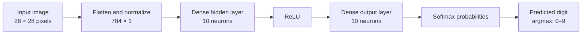
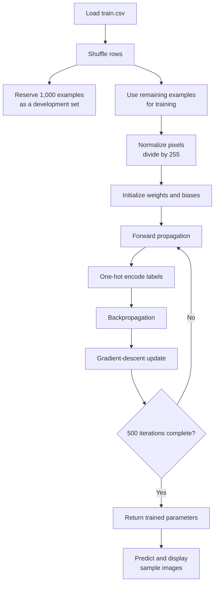

# Handwritten Digit Recognition with a Neural Network

A handwritten digit classifier built from scratch with **NumPy**. The project trains a small fully connected neural network on 28 × 28 grayscale digit images and implements the complete learning pipeline—parameter initialization, forward propagation, backpropagation, gradient descent, prediction, and visualization—without TensorFlow, PyTorch, or scikit-learn.

This repository is primarily an educational implementation for understanding what happens inside a neural network.

## Highlights

- Neural network and training loop implemented directly with NumPy
- ReLU hidden-layer activation and softmax output
- One-hot label encoding and full-batch gradient descent
- 10-class classification for digits `0` through `9`
- Training accuracy reported every 10 iterations
- Sample predictions displayed with Matplotlib
- Kaggle-style MNIST CSV data included in the repository

## Architecture

Each image is flattened from a 28 × 28 grid into a vector of 784 normalized pixel values.



The model uses these parameter shapes:

| Parameter | Shape | Purpose |
| --- | ---: | --- |
| `W1` | 10 × 784 | Maps input pixels to the hidden layer |
| `b1` | 10 × 1 | Hidden-layer bias |
| `W2` | 10 × 10 | Maps hidden activations to digit scores |
| `b2` | 10 × 1 | Output-layer bias |

For a batch of examples `X`, forward propagation is:

```text
Z1 = W1 · X + b1
A1 = ReLU(Z1)
Z2 = W2 · A1 + b2
A2 = softmax(Z2)
prediction = argmax(A2)
```

## Training Pipeline



The current script trains for **500 iterations** with a learning rate of **0.10**. It prints training predictions and accuracy every 10 iterations, then visualizes four examples.

## Project Structure

```text
.
├── dataset/
│   ├── train.csv       # 42,000 labeled images
│   └── test.csv        # 28,000 unlabeled images
├── src/
│   └── main.py         # Data preparation, model training, and demo
├── .gitignore
└── README.md
```

Each row of `train.csv` contains a `label` followed by 784 pixel columns (`pixel0` through `pixel783`). Pixel intensities range from 0 to 255. The script normalizes them to the range 0–1.

> The included `test.csv` is not currently used by `src/main.py`; the demonstration predicts samples from the training split.

## Getting Started

### Prerequisites

- Python 3.9 or newer
- `pip`

### 1. Clone the repository

```bash
git clone <repository-url>
cd handwritten_digit_recognization_neural_network
```

### 2. Create and activate a virtual environment

```bash
python -m venv venv
source venv/bin/activate
```

On Windows PowerShell, activate it with:

```powershell
venv\Scripts\Activate.ps1
```

### 3. Install dependencies

```bash
python -m pip install numpy pandas matplotlib
```

### 4. Configure the dataset path

`src/main.py` currently contains an absolute path from the original development machine. Before running the project, change:

```python
data = pd.read_csv('/home/pranil/python_projects/digit_recog_neural_network/dataset/train.csv')
```

to the repository-relative path:

```python
data = pd.read_csv('dataset/train.csv')
```

Run the next command from the repository root so that this relative path resolves correctly.

### 5. Train and run the demo

```bash
python src/main.py
```

During training, the terminal will show progress similar to:

```text
Iteration:  0
...
Iteration:  10
...
```

After training, Matplotlib opens four windows showing sample digits. Each prediction and its true label are also printed in the terminal. Close a plot window to continue to the next sample.

## How the Implementation Works

1. **Prepare the data:** The rows are shuffled, 1,000 examples are reserved as a development set, and the remaining examples are used for training.
2. **Normalize the pixels:** Dividing by 255 keeps every input value between 0 and 1, which makes optimization more manageable.
3. **Initialize parameters:** Weight matrices use scaled random initialization; biases start at zero.
4. **Run forward propagation:** The network produces a probability distribution over the ten digit classes.
5. **Backpropagate errors:** Analytical gradients are computed for both layers using one-hot-encoded labels.
6. **Update parameters:** Full-batch gradient descent adjusts weights and biases to reduce classification error.
7. **Predict:** The class with the highest output probability becomes the predicted digit.

## Current Scope and Limitations

- The data path must be changed manually before the first run.
- Training runs immediately when `src/main.py` is imported; there is no command-line interface or saved model checkpoint.
- The development split is prepared but is not used to report validation accuracy.
- The implementation uses full-batch gradient descent, which is simple but slower and more memory-intensive than mini-batch training.
- The softmax implementation does not apply a numerical-stability shift before exponentiation.
- No random seed is set, so shuffling, initialization, and final accuracy vary between runs.
- The code reports training accuracy only; this README intentionally does not claim a benchmark accuracy that has not been recorded reproducibly.

## Ideas for Further Development

- Resolve dataset paths automatically with `pathlib`
- Add command-line options for the learning rate and iteration count
- Evaluate and report development-set accuracy
- Save and reload trained weights
- Add mini-batch training and cross-entropy loss tracking
- Make softmax numerically stable
- Add automated tests and a dependency file
- Generate predictions for `dataset/test.csv`

## Contributing

Contributions are welcome. Fork the repository, create a focused branch, make and test your changes, and open a pull request explaining what changed and why.

## License

No license file is currently included. Unless a license is added, the repository's code remains under the default copyright terms of its author.
